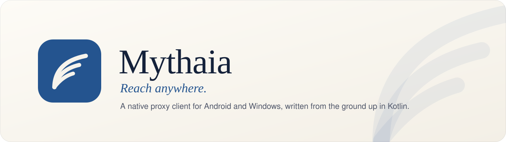
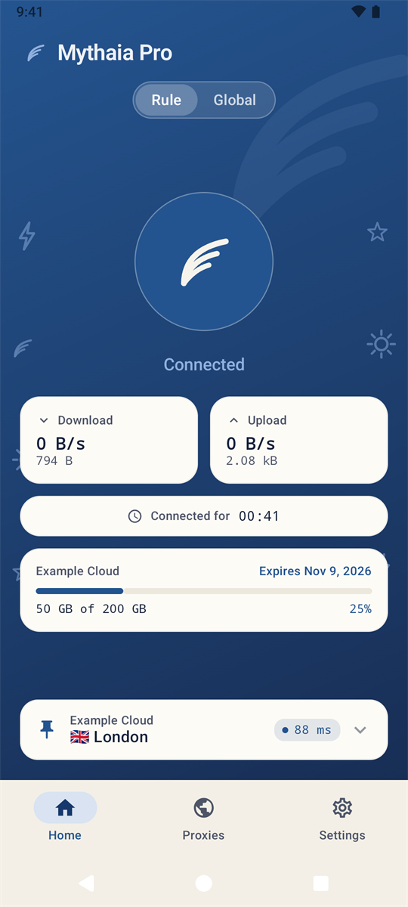
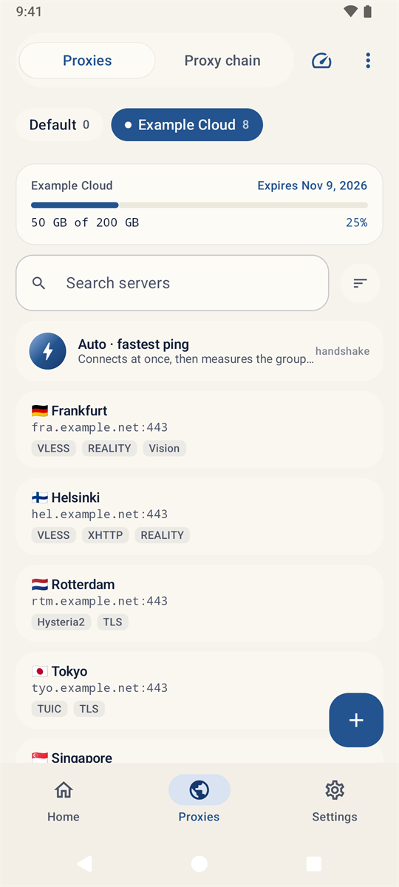
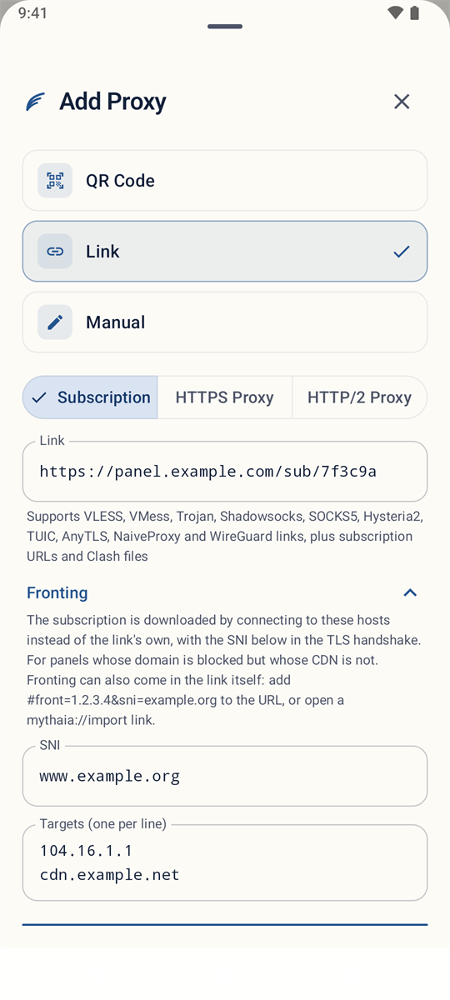
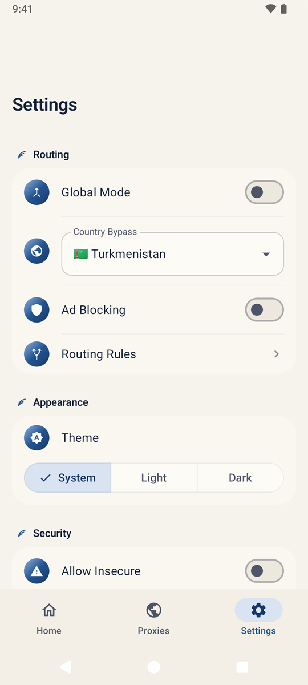

<div align="center">

<picture>
  <source media="(prefers-color-scheme: dark)" srcset="../assets/banner-dark.svg">
  
</picture>

<br>

[](https://github.com/Myth-T0ks1k/Mythaia/releases/latest)
[](https://github.com/Myth-T0ks1k/Mythaia/actions/workflows/ci.yml)
[](#скачать)
[](#скачать)
[](https://kotlinlang.org)
[](../../LICENSE.txt)
[](https://t.me/mythaia)
[](https://t.me/mythaia_chat)

[English](../../README.md) · **Русский** · [Türkmençe](README.tk.md) · [简体中文](README.zh-CN.md) · [فارسی](README.fa.md)

[Сайт](https://myth-t0ks1k.github.io/Mythaia/ru/) · [Скачать](#скачать) · [Возможности](#возможности) · [Фронтинг в одной ссылке](#фронтинг-в-одной-ссылке) · [Сборка](#сборка-из-исходников) · [Изменения](../../CHANGELOG.md)

</div>

---

Mythaia — прокси-клиент для **Android** и **Windows** с собственным сетевым стеком, написанным с нуля
на Kotlin. Он работает с VLESS и Reality, Hysteria2, TUIC, Trojan, Shadowsocks, WireGuard и другими
протоколами без обёртки над Xray-core или sing-box и рассчитан на сети с жёсткой фильтрацией:
доменный фронтинг, фрагментация ClientHello, ECH, автовыбор сервера и обход по стране встроены
в приложение, а не прикручены сбоку.

<div align="center">
  
  
  
  
</div>

## Почему Mythaia

- **Один нативный стек.** Протоколы, транспорты, TLS и маршрутизация написаны на Kotlin. Несколько
  небольших C-библиотек (lwIP, BLAKE3, libyaml, ngtcp2, Mbed TLS) берут на себя то, что лучше делать в нативном
  коде. Ни среды Go, ни мостов, лёгкий APK.
- **Две платформы, одно ядро.** Приложения для Android и Windows используют общий модуль `core`:
  ссылка, подписка или исправление ведут себя одинаково везде.
- **Создан для фильтруемых сетей.** Подписки скачиваются через фронт, серверы перемеряются
  и переключаются сами, местный трафик остаётся местным, а небезопасные настройки подписаны
  красным, а не спрятаны.

## Возможности

| | |
|---|---|
| **Протоколы** | VLESS (Vision, Reality, шифрование ML-KEM), VMess, Trojan, Shadowsocks (AEAD и 2022), Hysteria2 (Salamander, Brutal), TUIC v5, AnyTLS, NaiveProxy (HTTP/1.1, HTTP/2), WireGuard, SOCKS5, Sudoku |
| **Транспорты** | TCP, WebSocket с early data, HTTPUpgrade, gRPC, XHTTP (stream-one, stream-up, packet-up), QUIC |
| **TLS** | Отпечатки браузеров (Chrome, Firefox, Safari, iOS, Edge), Reality, ECH, фрагментация ClientHello, пиннинг сертификатов, *allow insecure* для отдельного сервера с заметным предупреждением |
| **Маршрутизация** | Режимы «По правилам» и «Глобальный», наборы правил по доменам, IP и GeoIP, обход по стране, раздельное туннелирование по приложениям, блокировка рекламы, Fake-IP DNS, DNS поверх HTTPS и TLS, IPv6 |
| **Серверы** | Ссылки, QR-коды, Clash YAML, JSON Xray и sing-box, цепочки прокси, Mux с XUDP, пинг по TCP или, для QUIC-серверов, по UDP; по рукопожатию или реальным HTTP-запросом; экспорт ссылками; удаление нерабочих |
| **Подписки** | Трафик и срок действия из панели, автообновление, объявления провайдера и мета-данные как у Happ (новый адрес, запасной адрес, инфо-блоки), Remnawave HWID, **доменный фронтинг для скачивания**, загрузка через рабочий сервер |
| **Авто** | Выбирает самый быстрый сервер группы, продолжает замеры и переключается только при заметном выигрыше; сам переподключается, когда сервер блокируют |
| **Android** | Плитка в шторке, виджет, постоянный VPN, Android TV, приложение для Wear OS, перехват HTTPS со своим сертификатом, 9 языков |
| **Windows** | Режим системного прокси (SOCKS5 и HTTP на одном порту) или полный TUN через Wintun, значок в трее, те же серверы, подписки и Авто |

## Скачать

Последняя версия — на странице **[Releases](https://github.com/Myth-T0ks1k/Mythaia/releases/latest)**.
Новые версии публикуются и в Telegram-канале [@mythaia](https://t.me/mythaia).

| Платформа | Файл | Примечание |
|---|---|---|
| Android | `Mythaia-1.3.1-android-universal.apk` | Для любого устройства: arm64, armeabi-v7a, x86, x86_64 |
| Android | `Mythaia-1.3.1-android-arm64-v8a.apk` | Компактнее, для современных телефонов |
| Wear OS | `Mythaia-1.3.1-wear-os.apk` | Дополнение к приложению на телефоне, Wear OS 3 и новее |
| Windows | `Mythaia-Pro-1.3.1-windows-x64-setup.exe` | Установщик для текущего пользователя, права администратора не нужны |
| Windows | `Mythaia-Pro-1.3.1-windows-x64.msi` | То же в виде MSI-пакета |
| Windows | `Mythaia-Pro-1.3.1-windows-x64-portable.zip` | Распакуйте куда угодно и запустите `Mythaia Pro.exe` |

В каждом релизе есть `SHA256SUMS.txt` с контрольными суммами всех файлов. Нужны Android 8.0 или
новее и Windows 10 или 11 (x64); для TUN-режима Windows попросит права администратора — каждый раз
или один раз при установке службы Mythaia, которая работает из своей копии в Program Files.

На Windows установить и обновлять его можно и через Scoop:

```pwsh
scoop bucket add mythaia https://github.com/Myth-T0ks1k/scoop-bucket
scoop install mythaia/mythaia-pro
```

## Фронтинг в одной ссылке

Панель, чей домен заблокирован, часто всё ещё доступна через незаблокированный CDN. Mythaia скачивает
подписку, подключаясь к **фронту** (адресу CDN или другому домену на нём): в TLS-рукопожатии
отправляется безобидный **SNI**, а настоящее имя панели — в HTTP-заголовке `Host`.

Настройки фронтинга можно передать прямо в ссылке. Тот, кому вы её отправите, добавит подписку
в один шаг, ничего не вводя вручную:

```text
https://panel.example.com/sub/TOKEN#front=104.16.1.1,cdn.example.net:443&sni=www.example.org
```

```text
mythaia://import?url=https://panel.example.com/sub/TOKEN&front=104.16.1.1&sni=www.example.org
```

| Параметр | Значение |
|---|---|
| `front` | Адреса, к которым идёт подключение: IP или домен, при необходимости с `:портом` (IPv6 — как `[адрес]:порт`). Перечисляются через запятую или повтором ключа и пробуются по порядку. |
| `sni` | Имя в TLS-рукопожатии (подходит и `front-sni`). Если указан только `sni`, подключение идёт к адресу самой панели, но под этим именем. |
| `name` | Необязательное название группы. |

- Первый вариант — обычный URL: часть после `#` никогда не уходит на панель, поэтому ссылка работает
  и в других клиентах.
- Второй вариант открывает Mythaia прямо из браузера или мессенджера.
- Если вставить, отсканировать или открыть любой из вариантов, поля **Фронтинг** в окне добавления
  заполнятся сами, и их можно проверить до скачивания.
- **Настройки подписки → Скопировать ссылку с фронтингом** превращает уже добавленную подписку в такую
  ссылку — и на Android, и на Windows.

Форма Happ, где в адресе — фронт, а в `host` — панель, тоже работает:

```text
https://cdn.example.net/sub/TOKEN#My%20VPN?resolve-address=104.16.1.1&host=panel.example.com
```

## Мета-данные подписки

Провайдер управляет подпиской так же, как в Happ. Каждый ключ читается из заголовков ответа, а если заголовка нет — из строки `#ключ: значение` в теле, над списком в base64 или внутри него. Текст может быть обычным или `base64:`; флаг включён при `true` или `1`.

```text
#profile-title: base64:TXkgVlBO
#profile-update-interval: 6
#fallback-url: https://backup.example.com/sub/TOKEN
#sub-info-text: Maintenance tonight 02:00–03:00 UTC
#sub-info-color: blue
vless://…
```

| Ключ | Действие |
|---|---|
| `profile-title`, `subscription-userinfo` | Имя группы; трафик и срок действия |
| `announce`, `support-url`, `profile-web-page-url` | Сообщение провайдера; кнопки «Поддержка» и «Личный кабинет» |
| `sub-info-text`, `sub-info-color` (`red`, `blue`, `green`), `sub-info-button-text`, `sub-info-button-link` | Цветной блок с кнопкой |
| `sub-expire` (or `notification-subs-expire`), `sub-expire-button-link` | Предупреждение за три дня до окончания, с кнопкой «Продлить» |
| `profile-update-interval` | Интервал фонового обновления, в часах |
| `subscription-auto-update-open-enable` | Обновлять при каждом открытии приложения |
| `subscription-auto-update-enable: 0` | Не обновлять эту подписку в фоне |
| `subscription-request-timeout` | Сколько секунд ждать панель |
| `new-url` | Подписка навсегда переезжает на этот адрес (фронтинг во фрагменте тоже читается) |
| `new-domain` | То же, но путь и параметры остаются |
| `fallback-url` | Загружается, если основной адрес вернул ошибку или не ответил за 10 секунд |
| `fronting-target` (or `resolve-address`) | Адреса, к которым подключаться вместо панели, через запятую; `off` выключает фронтинг |
| `fronting-sni` | SNI, который отправлять |
| `host` | Вместе с `resolve-address`: настоящий хост панели, как у Happ |

`new-url`, `new-domain`, `fallback-url` и ключи фронтинга берутся только из ответа, пришедшего по проверенному HTTPS: у панели на простом HTTP подписку мог бы перенаправить любой на пути.

Если обновление не удалось, внизу появляется полоска с кнопкой **Через рабочий сервер**: подписка скачивается через подключённый сервер или самый быстрый из ответивших на короткую проверку — так она обновляется, даже когда панель заблокирована совсем. Полоска исчезает сама.

## Сборка из исходников

**Требования:** JDK 21 и Android SDK с платформой 36. NDK и CMake Android Gradle Plugin установит
сам при первой сборке.

```bash
git clone https://github.com/Myth-T0ks1k/Mythaia.git
cd Mythaia
./gradlew :app:assembleDebug                  # отладочный APK для Android
./gradlew :core:test :app:testDebugUnitTest   # модульные тесты
```

Релизные сборки подписываются вашим собственным ключом. Добавьте эти строки в `local.properties`
(файл никогда не попадает в репозиторий) или задайте их переменными окружения:

```properties
KEYSTORE_FILE=/path/to/release.jks
KEYSTORE_PASSWORD=...
KEY_ALIAS=...
KEY_PASSWORD=...
```

`./gradlew :app:assembleRelease` собирает APK для arm64; с `-Pmythaia.universal=true` — для всех ABI.

<details>
<summary><b>Приложение для Windows</b></summary>

<br>

Для нативной библиотеки нужна Visual Studio 2022 с MSVC, CMake и Ninja; для упаковки — JDK 21
с `jmods`, путь к которому указывается в `local.properties` как `desktop.jdk`.

```bat
desktop\native\build.cmd
gradlew :desktop:run
gradlew :desktop:packageExe :desktop:packageMsi
```

Для установщиков нужен WiX 3.14 в `PATH`. Данные пользователя хранятся в `%APPDATA%\Mythaia`.

</details>

## Структура проекта

| Модуль | Что это |
|---|---|
| [`core`](../../core) | Kotlin без привязки к платформе: модели, ссылки, подписки, все протоколы и стек TLS |
| [`app`](../../app) | Приложение для Android: интерфейс на Jetpack Compose, `VpnService` и пользовательский стек TCP/IP на lwIP |
| [`wear`](../../wear) | Приложение для Wear OS: состояние подключения и включение в одно касание |
| [`desktop`](../../desktop) | Приложение для Windows: Compose for Desktop, движки системного прокси и TUN на Wintun |

Модуль `core` также опубликован в
[GitHub Packages](https://github.com/Myth-T0ks1k?tab=packages&repo_name=Mythaia) как
`com.mythaia:mythaia-core`.

## Участие

Сообщения об ошибках, идеи и pull request'ы приветствуются. Сначала прочитайте
[CONTRIBUTING.md](../../CONTRIBUTING.md), а об уязвимостях сообщайте приватно, как описано
в [SECURITY.md](../../SECURITY.md).

Вопросы и обсуждение — в Telegram-чате [@mythaia_chat](https://t.me/mythaia_chat) или в [GitHub Discussions](https://github.com/Myth-T0ks1k/Mythaia/discussions).

## Лицензия

Mythaia — свободное программное обеспечение под лицензией
[GNU General Public License v3.0](../../LICENSE.txt).

Проект основан на Anywhere от NodePassProject (GPL-3.0) и включает
[lwIP](https://savannah.nongnu.org/projects/lwip/), [BLAKE3](https://github.com/BLAKE3-team/BLAKE3),
[libyaml](https://github.com/yaml/libyaml), [ngtcp2](https://github.com/ngtcp2/ngtcp2), [Mbed TLS](https://github.com/Mbed-TLS/mbedtls),
[Wintun](https://www.wintun.net), [Bouncy Castle](https://www.bouncycastle.org) и
[Brotli](https://github.com/google/brotli) под их собственными лицензиями. Названия продуктов
в наборах правил маршрутизации принадлежат их владельцам.
